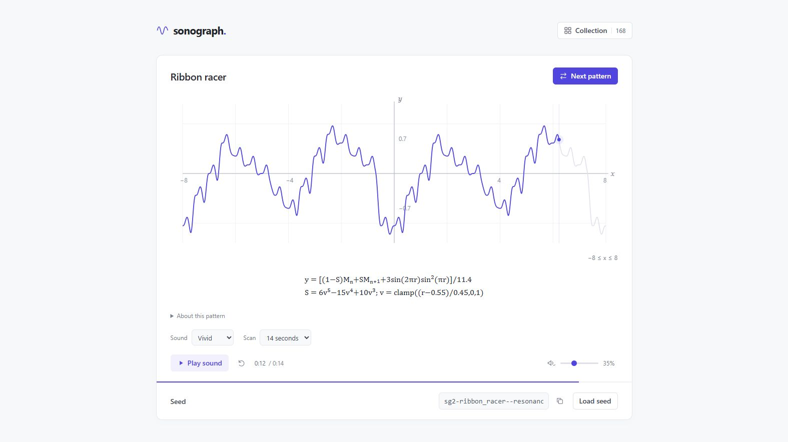

# Sonograph

See a mathematical pattern, then hear it play. Sonograph is a browser-based collection of 168 seeded patterns across 25 categories, from continuous pitch curves and cartoon sounds to geometric scores and miniature music machines.

**[Open Sonograph](https://prit36.github.io/Sonograph/)**



## Explore

- Browse searchable curve previews in the collection, or jump to the next pattern.
- Play mathematical curves, parametric shapes, rhythmic constructions, and original short compositions.
- Watch geometric scores animate with their musical events.
- Switch between Vivid and Original sound, with 7-second or 14-second scans.
- Copy a seed or share the page URL to replay a pattern with the same settings.
- Inspect equations, construction details, and mathematical references.

Try [Ribbon racer](https://prit36.github.io/Sonograph/?seed=sg2-ribbon_racer--resonance&sound=vivid&scan=7), [Orbit rave](https://prit36.github.io/Sonograph/?seed=sg2-orbit_rave--resonance&sound=vivid&scan=7), or [The final boss](https://prit36.github.io/Sonograph/?seed=sg2-video_final_boss--resonance&sound=vivid&scan=7).

## Run locally

The app uses plain HTML, CSS, JavaScript, Canvas, and Web Audio. There are no packages to install and no build step, backend, database, or external audio recordings.

```sh
git clone https://github.com/Prit36/Sonograph.git
cd Sonograph
python -m http.server 8765 --bind 127.0.0.1 --directory dist
```

Open **http://127.0.0.1:8765/** in a modern browser with Canvas and Web Audio support. Any static file server works. You can also open `dist/index.html` directly. Pattern generation and playback work offline; reference links require a connection.

Click **Play sound** to enable audio. Playback pauses when the page goes into the background.

## Controls

| Control | Action |
| --- | --- |
| Collection | Browse, search, and filter all 168 patterns. |
| Next pattern | Generate a new seeded pattern. |
| Play / Pause / Restart | Control playback and the visual scan. |
| Sound | Choose Vivid synthesis or the Original curve-to-tone renderer. |
| Scan | Choose 7 or 14 seconds without transposing the pitch mapping. |
| Volume | Adjust playback loudness. |
| Copy seed / Load seed | Save or recreate a pattern. |
| About this pattern | View equation details, voices, and references. |
| Space / N | Play or pause / next pattern when focus is outside a control. |

Some music machines expose additional controls below their canvas. Press Escape to close the collection.

## Seeds and sound

Named seeds use `sg2-family_id--entropy`, for example `sg2-ribbon_racer--resonance`. A seed determines the construction, coefficients, pitch, and voice. Plain `sg2-text` seeds choose a collection family; arbitrary text and legacy `sg1` seeds remain supported. Seeds are case-sensitive, trimmed, and limited to 128 characters. Saved seeds for patterns retired from browsing still load.

The URL stores the seed, sound mode, and scan duration. Identical seeds and settings reproduce the same generated samples in the same runtime; sound-device output can vary. Displayed coefficients are rounded for readability, while playback uses full internal precision.

Vivid synthesis includes harmonic voices, FM, plucked strings, granular chirplets, and event envelopes. Curves map height to pitch; compositions and geometric scores can use multiple synchronized voices. Audio is generated locally at 48 kHz with gain fades, level matching, and peak limiting. Original sound retains the earlier renderer; choose Original with a 14-second scan for legacy timing.

## Project layout

| Path | Contents |
| --- | --- |
| `dist/index.html` | App entry point. |
| `dist/engine.js`, `dist/catalog.js` | Seeded generation and base collection. |
| `dist/equations.js`, `dist/playground.js`, `dist/cartoon.js`, `dist/shapes.js` | Equation, musical, cartoon, and shape constructions. |
| `dist/machines*.js`, `dist/machine-controls.js`, `dist/songs.js` | Interactive music machines and short compositions. |
| `dist/performances*.js`, `dist/kinetic-scores.js` | Geometric musical scores and their rendering. |
| `dist/curve-play.js`, `dist/continuous-curves.js` | Original pitch functions and unbroken continuous curves. |
| `dist/sound.js`, `dist/player.js`, `dist/collection.js` | Synthesis, playback, controls, and collection browsing. |
| `dist/*.css` | Responsive interface styles. |
| `dist/*-*.html` | Browser-readable equation and listening notes. |
| `docs/images/` | README screenshots. |
| `.github/workflows/pages.yml` | GitHub Pages deployment. |

Despite its name, `dist/` contains the editable app source and is committed directly. Local research and work artifacts are excluded from Git.

## Publish changes

Push changes to `main` to deploy the contents of `dist/` through GitHub Actions. The workflow can also be run manually from the Actions tab. GitHub Pages must use **GitHub Actions** as its build source in the repository settings.

## Equations and references

- [Sources](SOURCES.md): mathematical families and synthesis references.
- [Video formula audit](VIDEO_FORMULAS.md): coverage of ten Matharium reference scenes. Eight visible constructions are implemented; The cowbell and The final boss use a disclosed original melody because the reference omits its melody list. The reference video is not bundled.
- [Listening notes](LISTENING_NOTES.md): musical constructions, curation, and continuous curves.
- [Music machines](MUSIC_MACHINES.md): interactive mechanisms and scores.
- [Pocket songs](POCKET_SONGS.md): original short compositions.
- [Visual scores](VISUAL_SCORES.md): geometric performances and equations.

## License

[MIT](LICENSE), copyright 2026 Prit36. Linked references remain the work of their respective authors.
